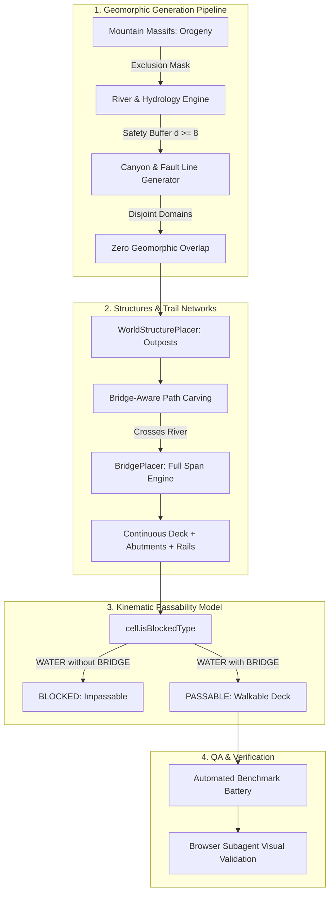

# Project Roadmap: Macro-Geomorphic Clearance & River Crossing Integrity

This roadmap establishes the architectural specifications to resolve macro-geomorphic landform collisions (eliminating all intersections between canyons, rivers, and mountains) and enforces the physical rule that any path crossing a watercourse must traverse an engineered bridge.

> [!NOTE]
> - **Roadmap 1 (Engine Core)**: Archival reference in [Documentation/roadmap1.md](file:///c:/Workspace/HTML%20Workspace/Browser-Sandbox/Documentation/roadmap1.md) (Viewport, Lerping, Vector Heading, Benchmarking, Modular A*, Bitmask Model).  
> - **Roadmap 2 (Structural Architecture)**: Archival reference in [Documentation/roadmap2.md](file:///c:/Workspace/HTML%20Workspace/Browser-Sandbox/Documentation/roadmap2.md) (Blueprints, Procedural Placer, Interactive Doors/Barricades, Roof Cutaways).  
> - **Roadmap 3 (Terrain & Hydrology)**: Archival reference in [Documentation/roadmap3.md](file:///c:/Workspace/HTML%20Workspace/Browser-Sandbox/Documentation/roadmap3.md) (Rivers, Lakes, Elevation Tiers, Chasms, Bridges, Riparian Ecology).  
> - **Roadmap 4 (Collision Resolution & Layer Precedence)**: Archival reference in [Documentation/roadmap4.md](file:///c:/Workspace/HTML%20Workspace/Browser-Sandbox/Documentation/roadmap4.md) (Cell flag hierarchy, CSS specificity cascades, seed-deterministic retries).  
> - Experimental concepts remain tracked in [sandbox.md](file:///c:/Workspace/HTML%20Workspace/Browser-Sandbox/sandbox.md).

---

## Roadmap Overview & Progress Matrix

| Phase | Milestone | Priority | Status | Target Release |
| :--- | :--- | :---: | :---: | :---: |
| **Phase 1** | **Hydrology & Orogeny Separation (Rivers vs Mountains)** | `P1 - High` | ✅ Completed | v6.0 |
| **Phase 2** | **Tectonic Fault Line Isolation (Canyons vs Rivers & Mountains)** | `P1 - High` | ✅ Completed | v6.1 |
| **Phase 3** | **Trail-River Bridge Synthesis & Mandatory Crossing Spans** | `P1 - High` | ✅ Completed | v6.2 |
| **Phase 4** | **Kinematic Passability Invariants & Strict Water Blocking** | `P2 - Medium` | ✅ Completed | v6.3 |
| **Phase 5** | **Geomorphic Clearance Benchmark & Topological Verification** | `P2 - Medium` | ✅ Completed | v6.4 |

---

## Technical Specifications & Phase Breakdown

### Phase 1: Hydrology & Orogeny Separation (Rivers vs Mountains)
* **Status**: ✅ Completed
* **Goal**: Guarantee that river channels, tributaries, and lakes never overlap, intersect, or slice through elevated mountain massifs ($h \ge 2$).

#### Problem Statement & Root Cause
1. **Blind River Routing Through Highland Ridges**:
   - In [RiverGenerator.js](file:///c:/Workspace/HTML%20Workspace/Browser-Sandbox/RiverGenerator.js), the primary river flows from $(-75, -70)$ to $(75, 65)$, cutting straight through the northwest quadrant.
   - In [ElevationService.js](file:///c:/Workspace/HTML%20Workspace/Browser-Sandbox/ElevationService.js), mountain ridges are centered at fixed coordinates:
     - Northwest Highlands: centered at $(-45, -45)$ with radius $22$ and peak radius $10$ ($h=3$).
     - Southeast Plateau: centered at $(50, 45)$ with radius $16$ and peak radius $7$ ($h=3$).
   - Because [RiverGenerator.js](file:///c:/Workspace/HTML%20Workspace/Browser-Sandbox/RiverGenerator.js) runs before [ElevationService.js](file:///c:/Workspace/HTML%20Workspace/Browser-Sandbox/ElevationService.js), water cells are carved first, and `ElevationService` then forces water cells to elevation $0$ while surrounding them with elevation $3$ mountain crags.
   - This creates an unnatural, sheer vertical trench where water cuts directly through mountain summits.

#### Architectural Solutions
1. **Disjoint Territory Allocation & Valley Corridors**:
   - Establish non-overlapping geographic domains for mountain massifs and river valleys:
     - Relocate mountain geological centers to dedicated quadrants outside the hydrological floodplain (e.g. Northwest crags shifted to $(-60, 20)$ or $(-20, -60)$ with a safety boundary).
     - Maintain a minimum Euclidean clearance buffer ($d_{\text{min}} \ge 8$ tiles) between any water cell ($h=0$) and any highland/mountain ridge ($h \ge 2$).
2. **Deflection-Steered River Raycasting**:
   - When [RiverGenerator.js](file:///c:/Workspace/HTML%20Workspace/Browser-Sandbox/RiverGenerator.js) traces its meander, query a repulsive potential vector field generated by mountain centers:
     $$\vec{F}_{\text{deflect}} = \sum_{r \in \text{Ridges}} \frac{\vec{x} - \vec{c}_r}{\|\vec{x} - \vec{c}_r\|^3}$$
   - Rivers naturally steer around highlands, flowing through flat lowland valleys ($h=1$).
3. **Topographic Clamping Invariant**:
   - In [ElevationService.js](file:///c:/Workspace/HTML%20Workspace/Browser-Sandbox/ElevationService.js), any cell within the hydrological corridor ($d(\text{water}) \le 6$) is strictly clamped to lowland meadow grade ($h=1$). Mountains are never permitted to generate within river channels.

---

### Phase 2: Tectonic Fault Line Isolation (Canyons vs Rivers & Mountains)
* **Status**: ✅ Completed
* **Goal**: Ensure tectonic fault lines (chasms) never intersect, enter, or bisect rivers, lakes, or mountain massifs.

#### Problem Statement & Root Cause
1. **Fault Lines Slicing Across Mountain Ridges**:
   - In [CanyonGenerator.js](file:///c:/Workspace/HTML%20Workspace/Browser-Sandbox/CanyonGenerator.js), Canyon 1 is carved from $(30, -55)$ to $(65, -15)$. The Northeast mountain ridge is centered at $(45, -35)$ with radius $18$. The canyon slices directly through the center of the Northeast crags.
   - Canyon 2 is carved from $(-55, 35)$ to $(-25, 65)$, slicing through the Southwest bluffs centered at $(-40, 40)$.
2. **Chasms Bisecting Hydrology Without Water Safety Checks**:
   - In `CanyonGenerator.carveFaultLine()`, line 59 checks `STRUCTURE_WALL` and `STRUCTURE_FLOOR`, but fails to check `CellFlags.WATER`!
   - As a result, a chasm can overwrite river tiles, creating illegal `WATER + CHASM` hybrid cells where river water vanishes into bottomless abysses without hydrological continuity.

#### Architectural Solutions
1. **Arid Rift Valley Relocation**:
   - Relocate canyon fracture lines to dedicated arid rift corridors positioned well away from both mountains and rivers (e.g. eastern lowlands and south-central plains).
2. **Strict Exclusion Masking During Fault Carving**:
   - Before applying `CellFlags.CHASM` to any cell:
     - If the cell or any neighbor within radius $r = 6$ contains `WATER` or `WATER_SHALLOW`, abort that step or deflect the fracture away.
     - If the cell or any neighbor contains elevation $h \ge 2$ (mountain/highland), deflect or terminate the fault line.
   - Formal Set Invariant:
     $$\forall c \in \text{MapCells}: c.\text{hasFlag}(\text{CHASM}) \implies \neg c.\text{hasFlag}(\text{WATER}) \land (c.\text{elevation} \le 1)$$
3. **No Mixed State Contradictions**:
   - `CHASM` cells are strictly forbidden from having `WATER`, and `WATER` cells are strictly forbidden from having `CHASM`.

---

### Phase 3: Trail-River Bridge Synthesis & Mandatory Crossing Spans
* **Status**: ✅ Completed
* **Goal**: Guarantee that any path, trail, or road crossing a river must do so exclusively via an engineered bridge spanning from shore to shore.

#### Problem Statement & Root Cause
1. **Disjointed Diagonal Trail Steps Across Water**:
   - In [WorldStructurePlacer.js](file:///c:/Workspace/HTML%20Workspace/Browser-Sandbox/WorldStructurePlacer.js), `carveTrail()` previously walked diagonally across river channels, stamping `STRUCTURE_PATH` and isolated `STRUCTURE_BRIDGE` on random individual tiles without spanning the full width of the river.
2. **Bare Trail Cells Walking on Water**:
   - If a trail steps into water without triggering a full bridge span, bare `STRUCTURE_PATH` tiles sit directly on `WATER`, giving the visual appearance of a gravel path running underwater.
3. **Lack of Bridge Prefab Attachment**:
   - Paths connect between structure doorways using Bresenham stepping rather than seeking out existing bridge locations or synthesizing engineered bridge structures.

#### Architectural Solutions
1. **Bridge-Aware Path Routing**:
   - In [WorldStructurePlacer.js](file:///c:/Workspace/HTML%20Workspace/Browser-Sandbox/WorldStructurePlacer.js), when `carveTrail(map, from, to)` plans a route:
     - Step 1: Detect if a direct line intersects water.
     - Step 2: If an existing bridge exists within reasonable distance, route the path through the existing bridge's abutments.
     - Step 3: If no bridge exists, invoke [BridgePlacer.js](file:///c:/Workspace/HTML%20Workspace/Browser-Sandbox/BridgePlacer.js) to construct a new, fully engineered shore-to-shore bridge across the river channel at the crossing coordinate.
2. **Full-Span Guarantee**:
   - Every river crossing must possess:
     - Solid ground abutments on both Shore A and Shore B (`STRUCTURE_PATH` on dry land).
     - Continuous unbroken bridge deck cells spanning 100% of the water gap (`STRUCTURE_BRIDGE | STRUCTURE_PATH`).
     - Parallel guide rails (`STRUCTURE_WALL`) on the open water flanks.
     - Elimination of bare `STRUCTURE_PATH` on water.

---

### Phase 4: Kinematic Passability Invariants & Strict Water Blocking
* **Status**: ✅ Completed
* **Goal**: Enforce engine-level passability rules ensuring that agents and pathfinders cannot enter river water under any circumstances unless walking on a bridge deck.

#### Problem Statement & Root Cause
1. **Permissive Water Passability in `cell.isBlockedType()`**:
   - In [cell.js](file:///c:/Workspace/HTML%20Workspace/Browser-Sandbox/cell.js) line 208:
     ```javascript
     if (this.flags & (CellFlags.STRUCTURE_PATH | CellFlags.STRUCTURE_BRIDGE | CellFlags.TERRAIN_RAMP | CellFlags.STRUCTURE_FLOOR)) return false;
     ```
   - If a cell has `CellFlags.WATER` and `CellFlags.STRUCTURE_PATH` (without `STRUCTURE_BRIDGE`), `isBlockedType()` returns `false` (passable)!
   - Furthermore, line 209:
     ```javascript
     if (this.flags & CellFlags.WATER_SHALLOW) return false;
     ```
     allows agents to wade through shallow water without any bridge or path.

#### Architectural Solutions
1. **Strict Water Blocking Contract in `cell.isBlockedType()`**:
   - Water is strictly impassable unless covered by an engineered bridge deck:
     ```javascript
     // Strict water blocking rule:
     if (this.flags & CellFlags.WATER) {
         // Only passable if an engineered bridge deck is present
         return (this.flags & CellFlags.STRUCTURE_BRIDGE) === 0;
     }
     ```
   - Having `STRUCTURE_PATH` alone on a `WATER` tile will NOT make it passable; `STRUCTURE_BRIDGE` is mandatory.
2. **Shallow Water Regulation**:
   - Disallow bare shallow water from being traversed along engineered roads: paths cannot treat shallow water as a bypass for a bridge.
3. **Neighbor Passability Graph Recalculation**:
   - Whenever a bridge is placed or modified, trigger `determineNeighboursPassable()` across the bridge deck and adjacent shorelines to ensure the navmesh accurately reflects bridge-only water traversal.

---

### Phase 5: Geomorphic Clearance Benchmark & Topological Verification
* **Status**: ✅ Completed
* **Goal**: Validate that all terrain and path collisions are 100% resolved via automated regression tests and interactive browser validation.

#### Deliverables & Test Cases
1. **Automated Geomorphic Collision Battery (`benchmark.js`)**:
   - **Test Case: River-Mountain Clearance**:
     $$\sum_{c \in \text{Map}} [c.\text{hasFlag}(\text{WATER}) \land c.\text{elevation} \ge 2] == 0$$
   - **Test Case: River-Canyon Disjointness**:
     $$\sum_{c \in \text{Map}} [c.\text{hasFlag}(\text{WATER}) \land c.\text{hasFlag}(\text{CHASM})] == 0$$
   - **Test Case: Canyon-Mountain Disjointness**:
     $$\sum_{c \in \text{Map}} [c.\text{hasFlag}(\text{CHASM}) \land c.\text{elevation} \ge 2] == 0$$
   - **Test Case: Mandatory River Bridge Invariant**:
     $$\sum_{c \in \text{Map}} [c.\text{hasFlag}(\text{WATER}) \land c.\text{hasFlag}(\text{STRUCTURE\_PATH}) \land \neg c.\text{hasFlag}(\text{STRUCTURE\_BRIDGE})] == 0$$
   - **Test Case: Water Navmesh Passability**:
     Verify that every passable water cell in the navmesh graph possesses `CellFlags.STRUCTURE_BRIDGE`.
2. **Browser Subagent Visual & Functional Verification**:
   - Reload page and verify map visual layout in SVG canvas.
   - Confirm mountain ranges are distinct from rivers, canyons occupy dry rift zones, and all trail river crossings feature complete bridges with guide rails and abutments.
   - Execute the 10-test benchmark suite with 100% pass rate.

---

## Architecture & Pipeline Flowchart



---

## Mathematical & Topological Invariants

```
+---------------------------------------------------------------------------------------+
|                             Macro-Geomorphic Separation                               |
|                                                                                       |
|  1. Water vs Mountains:                                                               |
|     ∀ c ∈ Cells : c.hasFlag(WATER) ⟹ c.elevation == 0 ∧ dist(c, Mountain) ≥ 6         |
|                                                                                       |
|  2. Canyon vs Water:                                                                  |
|     ∀ c ∈ Cells : c.hasFlag(CHASM) ⟹ ¬c.hasFlag(WATER) ∧ dist(c, Water) ≥ 6           |
|                                                                                       |
|  3. Canyon vs Mountains:                                                              |
|     ∀ c ∈ Cells : c.hasFlag(CHASM) ⟹ c.elevation ≤ 1 ∧ dist(c, Mountain) ≥ 6          |
+---------------------------------------------------------------------------------------+
                                           |
                                           v
+---------------------------------------------------------------------------------------+
|                              Mandatory Bridge Crossing                                |
|                                                                                       |
|  1. Path on Water Invariant:                                                          |
|     ∀ c ∈ Cells : (c.hasFlag(WATER) ∧ c.hasFlag(STRUCTURE_PATH))                      |
|                   ⟹ c.hasFlag(STRUCTURE_BRIDGE)                                       |
|                                                                                       |
|  2. Kinematic Passability:                                                            |
|     isBlockedType(c) : c.hasFlag(WATER) ⟹ (c.flags & STRUCTURE_BRIDGE) == 0          |
|                                                                                       |
|  3. Span Completeness:                                                                |
|     ∀ Bridge b : b.deck.isContiguous(ShoreA, ShoreB) ∧ b.abutments.isDryTerrain()      |
+---------------------------------------------------------------------------------------+
```
