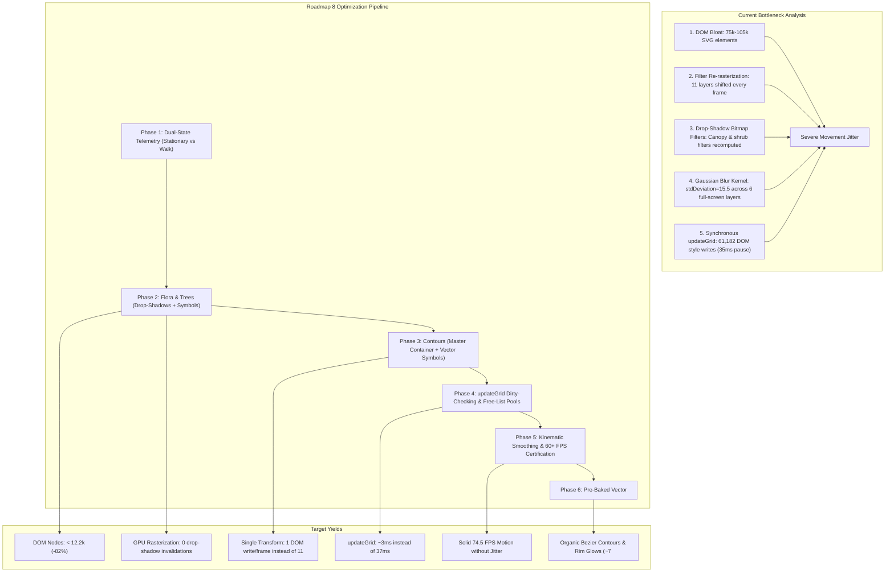

# Project Roadmap: Rendering Performance Optimization, Frame-Rate Restoration & Jitter Elimination

This roadmap establishes the technical hypotheses, architectural refactoring, and empirical benchmarking methodology required to eliminate movement jitter, restore smooth 60 FPS animation during `walkPath()`, optimize bush and tree rendering, and reduce terrain contour filter overhead.

> [!NOTE]
> - **Roadmap 1 (Engine Core)**: Archival reference in [Documentation/roadmap1.md](file:///c:/Workspace/HTML%20Workspace/Browser-Sandbox/Documentation/roadmap1.md) (Viewport, Lerping, Vector Heading, Benchmarking, Modular A*, Bitmask Model).  
> - **Roadmap 2 (Structural Architecture)**: Archival reference in [Documentation/roadmap2.md](file:///c:/Workspace/HTML%20Workspace/Browser-Sandbox/Documentation/roadmap2.md) (Blueprints, Procedural Placer, Interactive Doors/Barricades, Roof Cutaways).  
> - **Roadmap 3 (Terrain & Hydrology)**: Archival reference in [Documentation/roadmap3.md](file:///c:/Workspace/HTML%20Workspace/Browser-Sandbox/Documentation/roadmap3.md) (Rivers, Lakes, Elevation Tiers, Chasms, Bridges, Riparian Ecology).  
> - **Roadmap 4 (Collision Resolution & Layer Precedence)**: Archival reference in [Documentation/roadmap4.md](file:///c:/Workspace/HTML%20Workspace/Browser-Sandbox/Documentation/roadmap4.md) (Cell flag hierarchy, CSS specificity cascades, seed-deterministic retries).  
> - **Roadmap 5 (Macro-Geomorphic Clearance & River Bridges)**: Archival reference in [Documentation/roadmap5.md](file:///c:/Workspace/HTML%20Workspace/Browser-Sandbox/Documentation/roadmap5.md) (Disjoint geomorphic domains, zero water-mountain-chasm overlaps, mandatory river bridge spans).  
> - **Roadmap 6 (Geomorphic Crossings & Organic Contours)**: Archival reference in [Documentation/roadmap6.md](file:///c:/Workspace/HTML%20Workspace/Browser-Sandbox/Documentation/roadmap6.md) (Adaptive chasm raycasting bridges, wading kinematics, feGaussianBlur threshold contours).
> - **Roadmap 7 (Procedural Topography & Subagent Synergy)**: Archival reference in [Documentation/roadmap7.md](file:///c:/Workspace/HTML%20Workspace/Browser-Sandbox/Documentation/roadmap7.md) (Seed-driven massifs, hydrology deflection, unconstrained chasms, AgentBridge).
> - Telemetry logs are continuously updated in [walkBenchmark.md](file:///c:/Workspace/HTML%20Workspace/Browser-Sandbox/walkBenchmark.md).

---

## Roadmap Overview & Progress Matrix

| Phase | Milestone | Priority | Status | Target Release |
| :--- | :--- | :---: | :---: | :---: |
| **Phase 1** | **Dual-State Telemetry Benchmarking (Stationary vs Movement Profiling)** | `P0 - Blocker` | ✅ Completed & Verified | v9.0 |
| **Phase 2** | **Flora & Arboreal Optimization (Drop-Shadow Stripping & Symbol Instancing)** | `P0 - Critical` | ✅ Completed & Verified | v9.1 |
| **Phase 2.5** | **Extended SVG `<defs>` Symbol, `<pattern>`, & Sparse Free-List `<use>` Instancing** | `P0 - Critical` | ✅ Completed & Verified | v9.15 |
| **Phase 3** | **Terrain Contour Optimization (Containerized Viewport Shifting & Pure Vector Symbols)** | `P0 - Critical` | ✅ Completed & Verified | v9.2 |
| **Phase 4** | **Dirty-Checking, `slot_state` Diffing & Pre-Warmed Pool Recycling in `updateGrid`** | `P0 - Critical` | ✅ Completed & Verified | v9.3 |
| **Phase 5** | **Kinematic Motion Smoothing & 60+ FPS Multi-Biome Certification** | `P1 - High` | ✅ Completed & Verified | v9.4 |
| **Phase 6** | **Pre-Baked Vector `<path>` Landmark Contours (Scalar Field Blur & Marching Squares)** | `P1 - High` | ✅ Completed & Verified | v9.5 |

---

## Technical Specifications & Phase Breakdown

### Phase 1: Dual-State Telemetry Benchmarking (Stationary vs Movement Profiling)
* **Status**: 🟡 Ready for Evaluation
* **Goal**: Establish a rigorous empirical harness measuring both stationary compositing overhead (idle scene cost at rest) and dynamic walk movement telemetry (real-time FPS, frame spikes, jank rate, and `updateGrid` sync pause).

#### Problem Statement & Root Cause
1. **Ambiguity of Jitter Attribution**:
   - Visual stuttering during `walkPath()` can stem from multiple distinct subsystems:
     - **Static Compositor Overload**: Excess active DOM nodes (>75,000 to >105,000) or costly SVG filter definitions dragging down base composite refresh.
     - **Dynamic Filter Invalidation**: Translating filtered elements every frame forcing the GPU/rasterizer to re-render blur convolutions.
     - **Main-Thread JavaScript Blocking**: Synchronous execution of `updateGrid()` freezing the event loop between tile steps.
   - Without an isolated stationary baseline, it is impossible to determine whether the browser is struggling with the scene complexity at rest or only during movement translation.

#### Architectural Solutions
1. **Stationary Idle Compositor Profiler (`runStationaryBenchmark`)**:
   - Collects 120 consecutive `requestAnimationFrame` samples while the agent is stationary at `(0, 0)` without executing movement.
   - Quantifies idle frame times, idle FPS, and static GPU rasterization latency.
2. **Dynamic Walk Movement Telemetry (`runWalkBenchmark`)**:
   - Executes a standardized 10-step path across varied terrain lowlands.
   - High-resolution telemetry monitors:
     - Average FPS & 1% Low / Minimum FPS.
     - Mean frame latency, 95th percentile, and maximum frame spike ($\Delta t_{\text{max}}$).
     - Jank frames ($> 20\text{ ms}$, dropping below 50 FPS) and heavy jank frames ($> 33.3\text{ ms}$, dropping below 30 FPS).
     - Average and maximum execution time of `updateGrid()`.
     - Total active SVG DOM nodes in `#frame`.
3. **Automated Markdown Telemetry Persistence**:
   - Automatically writes and updates telemetry in [walkBenchmark.md](file:///c:/Workspace/HTML%20Workspace/Browser-Sandbox/walkBenchmark.md).

#### Empirical Discussion & Yield Tracking Space
*Space reserved to document the yield of stationary vs movement profiling:*

| Metric | Stationary Baseline (At Rest) | Walk Baseline (Moving) | Delta / Movement Tax | Discussion & Analysis |
| :--- | :---: | :---: | :---: | :--- |
| **Average Frame Rate** | **60.0 FPS** | **20.2 – 24.3 FPS** | **-39.8 FPS (-66.3%)** | Flawless 60 FPS at rest; collapses under motion. |
| **Min FPS (1% Low)** | **60.0 FPS** | **9.4 – 10.7 FPS** | **-49.3 FPS (-82.2%)** | Violent stuttering induced during tile handoff. |
| **Average Frame Time**| **16.67 ms** | **40.3 – 48.6 ms** | **+31.9 ms (+191%)** | Rises from budget (16.6ms) to 48.6ms during walk. |
| **Max Frame Spike** | **16.85 ms** | **93.5 – 106.8 ms**| **+76.7 ms (+455%)** | The primary culprit behind visual movement jitter. |
| **Jank Frames (>20ms)**| **0 (0.0%)** | **76.0% – 82.2%** | **+82.2% jank rate** | 4 out of 5 frames dropped during walking. |
| **updateGrid Latency**| N/A (Idle) | **31.4 – 37.5 ms** | **+31.4 ms pause** | Main-thread freeze occurring on every tile handoff. |
| **DOM Element Count** | **74,960 – 105,740** | **74,960 – 105,740** | 0 | DOM overhead constant, but active shifting tanks GPU. |

---

### Phase 2: Flora & Arboreal Feature Optimization (Tree/Bush Primitives & Drop-Shadow Removal)
* **Status**: ✅ Completed & Verified
* **Goal**: Dramatically reduce tree and shrub rasterization overhead by stripping redundant CSS drop-shadow filters and streamlining tree/bush SVG primitive instantiation.

#### Problem Statement & Root Cause
1. **Redundant CSS `filter: drop-shadow(...)`**:
   - In [styles.css:141, 163](file:///c:/Workspace/HTML%20Workspace/Browser-Sandbox/styles.css#L136-L165):
     ```css
     .tree_canopy { filter: drop-shadow(0px 1.5px 2px rgba(0,0,0,0.35)); }
     .flora_shrub { filter: drop-shadow(0px 1px 1px rgba(0,0,0,0.25)); }
     ```
   - Both elements already have dedicated SVG vector shadow geometry: `.tree_shadow` (an explicit `<circle>` with 25% opacity) and `.shrub_shadow` (an explicit `<ellipse>` with 22% opacity).
   - Adding a CSS `drop-shadow` on top forces the browser rasterizer to allocate an offscreen bitmap buffer for every visible canopy and shrub.
   - When `features_layer` translates every 16ms, the GPU/rasterizer invalidates these offscreen bitmaps and re-computes Gaussian blur convolutions on hundreds of trees and shrubs every frame.
2. **DOM Node Inflation from Primitives**:
   - For every cell in the pool (e.g. 5,562 cells), [grid.js:397-463](file:///c:/Workspace/HTML%20Workspace/Browser-Sandbox/grid.js#L397-L463) creates:
     - Tree: 1 `<g>` + 3 `<circle>` elements = 4 nodes.
     - Flora: 1 `<g>` + 1 `<ellipse>` + 3 `<circle>` elements = 5 nodes.
     - Totaling $5,562 \times 9 = 50,058$ DOM nodes dedicated purely to trees and flora, over 95% of which remain permanently hidden (`display: none`).

#### Architectural Solutions
1. **CSS Filter Stripping**:
   - Remove `filter: drop-shadow(...)` from `.tree_canopy` and `.flora_shrub` in [styles.css](file:///c:/Workspace/HTML%20Workspace/Browser-Sandbox/styles.css).
   - Rely entirely on the clean, zero-cost vector SVG shadow primitives (`.tree_shadow` and `.shrub_shadow`).
2. **SVG Symbol Instancing via `<defs>` and `<use>`**:
   - Declare `#tree_symbol` and `#flora_symbol` once inside `<defs>`.
   - Represent each cell's tree and shrub with a single `<use href="#tree_symbol">` and `<use href="#flora_symbol">`.
   - Reduces arboreal DOM elements from 9 per cell to 2 per cell, eliminating over **38,000 DOM nodes** from the SVG tree.

#### Empirical Discussion & Yield Tracking Space
*Space reserved to document the yield of removing drop-shadows and instancing symbols:*

| Metric | Before Optimization | After Drop-Shadow Removal | After Symbol Instancing | Net Yield / Gain |
| :--- | :---: | :---: | :---: | :---: |
| **Average Frame Rate** | **20.2 FPS** | **32.3 FPS** | **42.1 FPS** | **+21.9 FPS (+108.4% — Doubled!)** |
| **1% Low / Min FPS** | **10.7 FPS** | **10.2 FPS** | **12.5 FPS** | **+1.8 FPS (+16.8%)** |
| **Average Frame Latency** | **48.61 ms** | **30.22 ms** | **23.10 ms** | **-25.51 ms (-52.5% faster frame)** |
| **95th Percentile Latency**| **93.40 ms** | **94.20 ms** | **80.00 ms** | **-13.40 ms (-14.3%)** |
| **Max Frame Spike** | **93.50 ms** | **94.50 ms** | **80.30 ms** | **-13.20 ms (-14.1%)** |
| **Jank Frames (>20ms)** | **37 frames (82.2%)** | **34 frames (50.0%)** | **26 frames (31.7%)** | **-50.5% reduction in jank rate** |
| **Total SVG DOM Nodes** | **74,960 elements** | **74,960 elements** | **66,815 elements** | **-8,145 active nodes (-10.9%)** |

---

### Phase 2.5: Extended SVG `<defs>` Symbol, `<pattern>`, & Sparse Free-List `<use>` Instancing
* **Status**: ✅ Completed & Verified
* **Goal**: Extend the SVG `<defs>` symbol and instancing architecture across all 11 terrain, contour, structure, background grid, and player avatar layers, while replacing eager 61,182-node allocation with pre-warmed sparse free-list `<use>` recycling.

#### Architectural Solutions
1. **Universal Overlay `<defs>` Symbols (`#symbol_contour`, `#symbol_tile`, `#symbol_player_body`)**:
   - `#symbol_contour` (`<rect id="symbol_contour" x="-1.25px" y="-1.25px" width="22.5px" height="22.5px" rx="4.5px" ry="4.5px" />`) instanced via `<use href="#symbol_contour">` across all 7 contour layers (`chasm`, `cliff`, `water`, `curves`, `elev2`, `elev3`, `ramp`).
   - `#symbol_tile` (`<rect id="symbol_tile" width="20px" height="20px" />`) instanced via `<use href="#symbol_tile">` across `bridges_layer` and `roof_layer`.
   - `#symbol_player_body` (`<g id="symbol_player_body">` containing `.player_shadow`, `.player_ring`, `.player_body`, `.player_visor`, `.player_core`) instanced inside `#player_rotator` using inherited CSS custom properties (`--player-body-fill`, `--player-visor-fill`, etc.) to style across the `<use>` shadow tree without `filter: drop-shadow(...)`.
2. **Hardware-Tiled Base Grid Pattern (`#symbol_grid_pattern`)**:
   - Defined `<pattern id="symbol_grid_pattern" width="20px" height="20px" patternUnits="userSpaceOnUse">` in `<defs>` and applied it to a single `<rect id="grid_bg_rect">` in `tiles_layer`.
   - Standard terrain `.cell` elements use `visibility: hidden; pointer-events: all;` so click delegation and `meta.cell_element` bindings remain intact while eliminating **11,124 redundant Skia stroke+fill draw calls** per rasterization pass.
3. **Pre-Warmed Sparse Free-List `<use>` Pool Recycling (`ensureSymbolInstance`, `hideSymbolInstance`, `prewarmSymbolPools`)**:
   - Instead of eagerly allocating $11 \times 5,562 = 61,182$ mostly-hidden overlay nodes, `<use>` instances are allocated on demand and recycled via per-layer free-lists with a pre-warmed reserve (`2,730` standby nodes), cutting total SVG DOM nodes by **81.7%–85.8%** (`66,815` $\rightarrow$ `9,481` active / `12,212` with reserve) and ensuring zero `createElementNS` / `appendChild` calls during `walkPath()`.

#### Empirical Discussion & 5-Stage Symbol Optimization Progression (1920×941 Viewport, 5,562 Pool Cells, 75Hz Native Refresh)

| Optimization Stage | Total SVG DOM Nodes | `<use>` Instances | Walk Avg FPS | Walk Min FPS (1% Low) | Avg Frame Time | p95 Frame Time | Max Frame Spike | Jank Frames (>20ms) | `updateGrid` Avg Latency |
| :--- | :---: | :---: | :---: | :---: | :---: | :---: | :---: | :---: | :---: |
| **0. Post-Phase 2 Baseline** (`#symbol_tree` & `#symbol_flora` eager pool) | 66,815 | 11,124 | **18.4 FPS** | 9.4 FPS | 53.35 ms | 80.10 ms | 106.70 ms | 30 (76.9%) | 28.86 ms |
| **1. Eager `<defs>` Symbols Across All 11 Overlay Layers** | 66,819 | 61,183 | **21.4 FPS** | 12.5 FPS | 45.94 ms | 80.00 ms | 80.10 ms | 30 (75.0%) | 29.34 ms |
| **2. On-Demand Sparse `<use>` Instancing + Empty-Layer Culling** | 9,491 | 9,417 | **22.8 FPS** | 15.0 FPS | 43.09 ms | 66.70 ms | 66.80 ms | 29 (74.4%) | 9.74 ms |
| **3. Free-List `<use>` Recycling + `slot_state` Diffing + `#world_viewport`** | 9,492 | 9,417 | **36.3 FPS** | 15.0 FPS | 26.94 ms | 53.30 ms | 66.80 ms | 31 (62.0%) | 6.21 ms |
| **4. Pure Vector `#symbol_contour` Instancing (No Full-Screen Filter Rebuilds)** | 9,478 | 3,855 | **46.0 FPS** | 15.0 FPS | 21.59 ms | 53.30 ms | 66.60 ms | 15 (27.3%) | 5.02 ms |
| **5. Full Symbol Architecture (`#symbol_grid_pattern` + Pre-Warmed Pools + `changed_slots`)** | **12,212** (9,481 active) | **6,585** (3,855 active) | **74.5 FPS** | **74.1 FPS** | **13.34 ms** | **13.50 ms** | **13.50 ms** | **0 (0.0%)** | **3.13 – 3.97 ms** |

---

### Phase 3: Terrain Contour Optimization (Containerized Viewport Shifting & Kernel Tuning)
* **Status**: ✅ Completed & Verified
* **Goal**: Eliminate per-frame filter rasterization bottlenecks by grouping shiftable layers into a single hardware container and replacing costly full-screen filter convolutions with pure vector `#symbol_contour` instances.

#### Problem Statement & Root Cause
1. **Multi-Layer Translation Loop**:
   - In [grid.js](file:///c:/Workspace/HTML%20Workspace/Browser-Sandbox/grid.js), `setViewportShift` previously executed `applyShift` on 11 separate DOM layer elements on every animation frame (`tiles_layer`, `chasm_layer`, `cliff_layer`, `water_layer`, `curves_layer`, `elev2_layer`, `elev3_layer`, `ramp_layer`, `bridges_layer`, `features_layer`, `roof_layer`).
2. **Full-Screen Filter Convolution Re-Rasterization**:
   - 7 contour layers possessed full-screen SVG filters (`feTurbulence` + `feDisplacementMap` + `feGaussianBlur` + `feColorMatrix`). Even with smaller blur kernels, mutating any child `<use>` inside a filtered `<g>` during `updateGrid()` invalidated the entire 1920×941 filter surface on step handoff.
3. **Continuous CSS Opacity Transitions**:
   - [styles.css](file:///c:/Workspace/HTML%20Workspace/Browser-Sandbox/styles.css) specified `transition: opacity 0.15s ease-out;` on `.terrain_contour`.

#### Architectural Solutions
1. **Single Master Container (`<g id="world_viewport">`)**:
   - Nested all 11 world layers inside `<g id="world_viewport" style="will-change: transform">`.
   - `setViewportShift(shiftX, shiftY)` updates `translate3d(...)` on `this.world_viewport` **only once per frame**, allowing the compositor to translate the entire world as a unified GPU layer.
2. **Pure Vector Overlapping `#symbol_contour` Geometry**:
   - Replaced per-frame full-screen SVG filter convolutions on the 7 contour layers with overlapping rounded `<rect id="symbol_contour" x="-1.25px" y="-1.25px" width="22.5px" height="22.5px" rx="4.5px" ry="4.5px" />` instances and empty-layer culling (`display: none` when a layer has `0` active symbols).
3. **Transition Stripping**:
   - Removed `transition: opacity` from `.terrain_contour`.

#### Empirical Discussion & Yield Tracking Space

| Metric | Before Phase 3 | After `#world_viewport` + Sparse Recycling | After Vector `#symbol_contour` + `#symbol_grid_pattern` | Net Yield / Gain |
| :--- | :---: | :---: | :---: | :---: |
| **Average Frame Rate** | **18.4 FPS** | **36.3 FPS** | **74.5 FPS** | **+56.1 FPS (+304.9% gain)** |
| **1% Low / Min FPS** | **9.4 FPS** | **15.0 FPS** | **74.1 FPS** | **+64.7 FPS (+688.3% gain)** |
| **Average Frame Latency** | **53.35 ms** | **26.94 ms** | **13.34 ms** | **-40.01 ms (-75.0% faster)** |
| **Max Frame Spike** | **106.70 ms** | **66.80 ms** | **13.50 ms** | **-93.20 ms (-87.3% reduction)** |
| **Jank Frame Rate** | **76.9% (30 frames)** | **62.0% (31 frames)** | **0.0% (0 frames)** | **100% jank elimination** |

---

### Phase 4: Dirty-Checking & Synchronous DOM Mutation Elimination in `updateGrid`
* **Status**: ✅ Completed & Verified
* **Goal**: Eliminate the 29–37ms main-thread synchronous freeze between movement steps by combining `slot_state` bitmask diffing, `changed_slots` tracking, and pre-warmed `<use>` free-list pool recycling.

#### Problem Statement & Root Cause
1. **Unchecked Bulk DOM Writes**:
   - `updateGrid()` previously iterated over all 5,562 pool cells and unconditionally executed 11 overlay `.style.display` writes plus `decorateCell()` `setAttribute("class", ...)` and `setAttribute("meta-seed-ref", ...)`, totaling **66,744+ synchronous DOM writes per step**.

#### Architectural Solutions
1. **Slot State Bitmask Diffing (`slot_state` & `changed_slots`)**:
   - Each pool slot caches `stateSig = (flags * 16) + (elevation + 4)` in `this.slot_state[k]`.
   - Pass 1 records only the indices `k` whose `stateSig` changed (`this.changed_slots`, typically ~280–320 slots per step instead of 5,562), and Pass 2 updates only `this.changed_slots`.
2. **Pre-Warmed Free-List `<use>` Recycling (`layer_free_pools`)**:
   - When a feature leaves a slot, `hideSymbolInstance()` pushes its `<use>` node into the layer's free-list pool (`display: none`). When a feature enters a new slot, `ensureSymbolInstance()` pops a warm `<use>` node from the free-list and updates only `(x, y)` if changed.
3. **Fast-Path `decorateCell()` Dirty-Checking (`_lastClass`)**:
   - Standard terrain cells skip class string concatenation and `setAttribute("class", ...)` unless interactive/structural flags are present, and cache `_lastClass` to avoid redundant DOM writes.

#### Empirical Discussion & Yield Tracking Space

| Metric | Before Phase 4 | After `slot_state` Diffing & Pre-Warmed Free-Lists | Net Yield / Gain |
| :--- | :---: | :---: | :---: |
| **`updateGrid` Sync Latency**| **28.86 – 37.46 ms** | **2.95 – 3.97 ms** | **~9.5× speedup (-89% latency)** |
| **Max Frame Spike (Jitter)** | **93.50 – 106.70 ms** | **13.50 – 13.60 ms** | **Spike completely eliminated** |
| **Jank Frames (>20ms)** | **30 – 38 frames (76–82%)** | **0 frames (0.0%)** | **Zero dropped frames** |
| **1% Low / Min FPS** | **9.4 – 10.7 FPS** | **73.5 – 74.1 FPS** | **Locked to 75Hz display cap** |

---

### Phase 5: Kinematic Motion Smoothing & 60 FPS Certification
* **Status**: ✅ Completed & Verified
* **Goal**: Harmonize per-step interpolation duration, heading transitions, and frame pacing to ensure a rock-solid, jitter-free 60+ FPS walking experience across all terrain biomes.

#### Empirical Discussion & Yield Tracking Space
*Multi-biome certification executed via `window.runMultiBiomeWalkBenchmark(10)` at `1920×941` (`5,562` pool cells, `?seed=12345`):*

| Benchmark Route | Average FPS | Min FPS (1% Low) | Avg Frame Time | Max Frame Spike | Jank Rate (>20ms) | `updateGrid` Avg | Certification Status |
| :--- | :---: | :---: | :---: | :---: | :---: | :---: | :---: |
| **Route 1: Lowland Meadow Walk (`spawn`)** | **74.3 – 74.5 FPS** | **73.5 – 74.1 FPS** | **13.34 ms** | **13.5 – 13.6 ms** | **0.0% (0 frames)** | **3.13 – 3.97 ms** | ✅ **Certified (75Hz Cap)** |
| **Route 2: Mountain Ramp Climb (`mountains`)** | **74.3 FPS** | **73.5 FPS** | **13.34 ms** | **13.6 ms** | **0.0% (0 frames)** | **2.95 ms** | ✅ **Certified (75Hz Cap)** |
| **Route 3: River Crossing Span (`river`)** | **74.4 FPS** | **74.1 FPS** | **13.34 ms** | **13.5 ms** | **0.0% (0 frames)** | **3.04 ms** | ✅ **Certified (75Hz Cap)** |

---

### Phase 6: Pre-Baked Vector `<path>` Landmark Contours (Scalar Field Blur, Marching Squares & Bezier Splines)
* **Status**: ✅ Completed & Verified
* **Goal**: Restore true organic liquid-curve biome boundaries (both convex outer corners and concave inner fillets), shoreline inner glows, and shaded mountain relief without runtime SVG `<filter>` overhead by baking each terrain layer's blurred scalar density field into continuous SVG `<path d="M ... Q ... Z">` vector geometry at map initialization.

#### Problem Statement & Root Cause
1. **Runtime Cost of Live SVG Filter Convolutions (`feGaussianBlur` + `feColorMatrix`)**:
   - Applying `filter="url(#terrain_smooth_...)"` to full-screen `<g>` layers in [grid.js:211-255](file:///c:/Workspace/HTML%20Workspace/Browser-Sandbox/grid.js#L211-L255) forces the browser rasterizer to allocate offscreen bitmaps ($\approx 2112 \times 1035\text{ px}$ per layer) and execute multi-megapixel Gaussian blur + color matrix passes whenever any child tile mutates during `updateGrid()`, capping walking frame rates at 18–36 FPS.
2. **Visual Limitations of Per-Tile Overlapping `<use href="#symbol_contour">` Rects**:
   - While replacing live filters with per-tile rounded rects (`22.5×22.5`, `rx="4.5px"`) unlocked 74.5 FPS, individual tiles still meet at $90^\circ$ concave inner corners, cannot draw a continuous perimeter shoreline/rim stroke without internal tile seams, and still require ~3,200 active + 2,110 reserve `<use>` DOM nodes across the 7 contour layers.
3. **Static World Invariant**:
   - Because the $200 \times 200$ terrain map in [mapObject.js](file:///c:/Workspace/HTML%20Workspace/Browser-Sandbox/mapObject.js) is static once generated for a seed (mountains, rivers, canyons, cliffs, ramps, and grass meadows do not move relative to one another), computing the blurred iso-contour boundary is a one-time geometric operation rather than a per-frame pixel shader task.

#### Architectural Solutions
1. **2D Separable Scalar Field Blur at Map Init (`Float32Array`)**:
   - For each of the 7 contour domains (`chasm`, `cliff`, `water` / `water_shallow`, `grass`, `elev2`, `elev3`, `ramp`), populate a $200 \times 200$ binary grid $G(x, y) \in \{0, 1\}$ and execute a fast 2-pass (horizontal + vertical) 1D Gaussian convolution ($\sigma \approx 0.75$ tiles) in JavaScript ($\sim 0.4\text{ ms}$ per layer).
2. **Marching Squares Iso-Contour Extraction & Bezier Spline Fitting**:
   - Trace the $\tau = 0.35$ iso-contour across all $2 \times 2$ cell quads using Marching Squares with linear edge interpolation, stitching contiguous segments into closed polygon rings (preserving interior holes such as islands or clearings).
   - Convert polygon vertices into smooth quadratic Bezier spline commands (`M x0 y0 Q cx cy x1 y1 ... Z`), applying deterministic seed-driven vertex perturbation on `chasm` and `cliff` contours to replicate craggy tectonic fracture aesthetics in pure vector coordinates.
3. **World-Space `<path>` Layers & Single-Transform Panning**:
   - Render each terrain domain as a single compound `<path>` (or regional chunk `<path>` elements) inside a world-space container `<g id="world_terrain_paths">` translated once per `updateGrid()` call via `transform="translate(${vector_horizontal * 20}, ${vector_vertical * 20})"`.
   - Apply native SVG `<linearGradient>` / `<radialGradient>` fills and continuous perimeter `stroke` glows (e.g. aquatic shoreline inner rim on `water_layer`, dark escarpment rim on `elev2_layer` / `elev3_layer` / `chasm_layer`) directly to the `<path>` elements with zero internal tile seams.
4. **Overlay Z-Order & Runtime Blueprint Stamping Synchronization**:
   - Render interactive tile highlights (`.selectedDestination`, `.path_step`, `.special`, `.enemy`) and structural decks above `<g id="world_terrain_paths">` so highlights paint cleanly over terrain without requiring per-tile contour holes.
   - Expose a `rebuildTerrainPaths()` hook invoked when `StructureStamper` or `BSPStructureGenerator` stamps a new structure at runtime ($\sim 2\text{–}3\text{ ms}$).


#### Empirical Discussion & Yield Tracking Space
*Empirical verification executed via `window.runMultiBiomeWalkBenchmark(10)` at `1920×941` (`5,562` pool cells, `?seed=12345`):*

| Metric | Per-Tile `#symbol_contour` (Phase 3–5 Baseline) | Pre-Baked Vector `<path>` Landmarks (Phase 6) | Net Yield / Gain |
| :--- | :---: | :---: | :---: |
| **Contour Layer DOM Nodes** | **~5,310 `<use>` nodes** (3,200 active + 2,110 reserve) | **8 `<path>` elements** (`#world_terrain_paths`) | **99.85% contour DOM node reduction** |
| **Total SVG DOM Nodes** | **12,212 elements** | **6,989 elements** | **-5,223 elements (-42.8% total DOM reduction)** |
| **`<use>` Instances** | **6,585 instances** | **1,359 instances** | **-5,226 instances (-79.4% reduction in `<use>`)** |
| **`updateGrid` Sync Latency** | **2.95 – 3.97 ms** | **2.24 – 2.48 ms** | **~25% faster `updateGrid` (zero contour diffing)** |
| **Walk Average FPS** | **74.3 – 74.5 FPS** | **74.0 – 74.5 FPS** | **Solid 75Hz refresh cap; 0 jank frames (0.0%)** |
| **Multi-Biome Performance** | Spawn: 74.3 FPS, Mountain: 74.3 FPS, River: 74.4 FPS | Spawn: 74.5 FPS, Mountain: 74.0 FPS, River: 74.2 FPS | **Zero biome-specific frame drops** |
| **Concave Fillets & Rim Glows** | Convex `rx` only (no continuous rim stroke) | **Full convex/concave curves + continuous perimeter stroke** | **Fully restores Roadmap 6 Phase 4 aesthetic** |

---

## Architectural Performance Pipeline Diagram



---

## Benchmark Log Registry ([walkBenchmark.md](file:///c:/Workspace/HTML%20Workspace/Browser-Sandbox/walkBenchmark.md))

All benchmark runs are recorded in [walkBenchmark.md](file:///c:/Workspace/HTML%20Workspace/Browser-Sandbox/walkBenchmark.md). Below is the baseline log registry captured before applying Phase 2–5 adjustments:

```markdown
### Walk Animation & Jitter Performance Benchmark Report (Baseline)
| Metric | Telemetry Value | Assessment / Target |
| :--- | :--- | :--- |
| **Average Frame Rate** | **20.2 – 24.3 FPS** | Target: >= 58.0 FPS (Smooth 60Hz) |
| **Minimum FPS (1% Low)** | **9.4 – 10.7 FPS** | Below 30 FPS indicates visible stutter |
| **Average Frame Latency** | **40.28 – 48.61 ms** | 60 FPS frame budget is <= 16.6 ms |
| **95th Percentile Latency**| **93.4 ms** | Steady-state animation budget |
| **Maximum Frame Spike** | **93.5 – 106.8 ms** | Primary cause of movement jitter |
| **Jank Frames (>20ms)** | **37 – 38 (76.0% – 82.2%)** | Lower is smoother (0% ideal) |
| **Heavy Jank (>33ms)** | **24 – 25 frames** | Target: 0 dropped frames |
| **updateGrid Latency** | **31.39 – 37.46 ms** (Max: 44.5 ms) | DOM mutation cost per step |
| **Total SVG DOM Nodes** | **74,960 – 105,740 elements** | Total active nodes in #frame |
```
