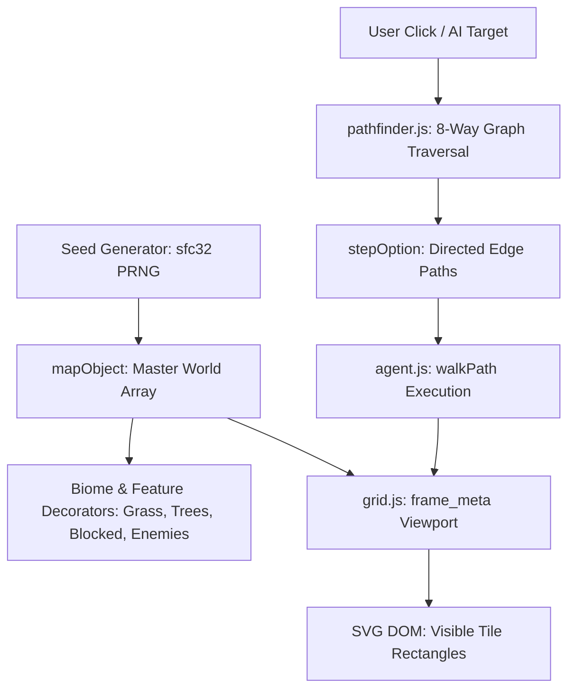

# Grid Engine (V3)

A lightweight, procedural 2D tile engine and autonomous agent navigation system built in vanilla JavaScript, SVG, and CSS. The engine simulates a seeded, procedurally generated infinite-feeling world with biomes, interactive obstacles, dynamic viewport scrolling, and multi-directional pathfinding.

---

## Architecture Overview



The system is organized into modular layers:

1. **Procedural World Generation (`mapObject.js`)**:
   - Seeded with a 128-bit state via the `sfc32` (Small Fast Counter 32-bit) pseudorandom algorithm.
   - Generates world cells with normalized coordinate origins `(0, 0)`.
   - Procedural features include randomized circular clearings (radius $\le 10$), clustered tree groves, natural rock formations, and enemy spawns.

2. **Relative Viewport & Camera (`grid.js`)**:
   - Computes visible columns and rows based on container dimensions (`clientWidth` / `clientHeight`) and fixed cell size (20px).
   - Anchors the agent at the screen center `(grid_mid_x, grid_mid_y)` mapped directly to world coordinates `(0, 0)`.
   - Virtual out-of-bounds boundary guards: dynamically synthesizes blocked padding if the camera pans past map boundaries.

3. **Cell State & Decorator Pattern (`./Agent States/*.js`)**:
   - Cells are wrapped in composable decorators that inherit from `cell_meta` and layer CSS classes dynamically:
     - `CellDecoration`: Base floor tile.
     - `GrassDecoration`: Lush vegetation tiles created during radial biome generation.
     - `TreeDecoration`: Choppable woodland obstacles with custom click interactions.
     - `BlockedDecoration`: Impassable terrain/stone barriers.
     - `EnemyDecoration`: Interactive hostile entities registered in `all_agents`.
     - `AgentDecoration` / `WalkingAgentDecoration` / `ThinkingAgentDecoration`: Player visualization states.
     - `SelectedDecoration`: Destination beacon highlight.

4. **8-Way Graph Traversal & Pathfinding (`pathfinder.js`, `stepOption.js`)**:
   - 8-neighbour connectivity (North, South, East, West, NW, NE, SW, SE).
   - **Corner-Cutting Prevention**: Diagonal moves verify that adjacent orthogonal tiles are clear, preventing entities from clipping through wall corners.
   - Directed edge structure (`stepOption`) links `stepOptionFromCell` to `stepOptionToCell` with configurable transition weights.
   - Greedy recursive search (`findUniquePathRecurseGPT`) with distance-based heuristic sorting, branch-and-bound pruning, and scoped `visited` Map backtracking.
   - UI disclosure panel listing all explored candidate paths with live hover inspection.

5. **Motion Controller (`agent.js`)**:
   - Consumes `stepOption` paths.
   - Updates camera tracking vectors (`vector_horizontal`, `vector_vertical`) per step.
   - Executes two-phase final step completion (`step_final`) to seamlessly arrive and clear destination highlights.

---

## Project Structure

```text
├── Agent States/
│   ├── agentStateDecoration.js         # Base player decoration class
│   ├── blockedStateDecoration.js       # Impassable barrier tile decorator
│   ├── cellStateDecoration.js          # Base tile decoration wrapper
│   ├── enemyAgentDecoration.js         # Hostile NPC entity decorator
│   ├── grassStateDecoration.js         # Vegetated ground decorator
│   ├── selectedStateDecoration.js      # Destination beacon decorator
│   ├── thinkingAgentStateDecoration.js # Path-calculating state decorator
│   ├── treeStateDecoration.js          # Interactive foliage / woodcutting
│   └── walkingAgentStateDecoration.js  # Active movement state decorator
├── agent.js                            # Player metadata, path execution, walkPath()
├── behaviour.js                        # Global state, sfc32 PRNG, event bindings, init()
├── benchmarking.txt                    # Performance and recursion telemetry logs
├── cell.js                             # cell_meta: 8-way adjacency, distance, decorators
├── grid.js                             # frame_meta: Viewport sizing, SVG tile rendering
├── mapObject.js                        # Master world matrix, seed caching, biome generation
├── pathfinder.js                       # 8-neighbour recursive pathfinding & path sorting
├── stepOption.js                       # Directed edge model (fromCell -> toCell)
├── styles.css                          # Theme styles, tile colors, options disclosure UI
└── test_grid.html                      # Main browser entry point
```

---

## Getting Started

### Prerequisites
A modern web browser supporting ES6, SVG, and CSS3 (Chrome, Edge, Firefox, Safari). No build tools, bundlers, or package managers are required.

### Launching the Application
1. Open `test_grid.html` directly in any web browser:
   ```bash
   # Windows PowerShell
   Start-Process test_grid.html
   ```
2. Or serve it via any static file server:
   ```bash
   npx serve .
   ```

---

## Controls & Interactivity

| Action | Control | Result |
| :--- | :--- | :--- |
| **Move Agent** | Left-click any unblocked cell | Computes optimal path, highlights destination, and walks the agent. |
| **Chop Tree** | Left-click adjacent tree ($\text{dist} \le 1.4$) | Chops the tree down, converts to passable grass, and updates neighbour graphs. |
| **Interact with Enemy** | Left-click adjacent enemy ($\text{dist} \le 1.4$) | Interacts with hostile unit, clears cell, and updates neighbour graphs. |
| **Inspect Paths** | Hover over candidate path in "Options" | Highlights the candidate route in red (`.path_step`) on the active grid. |

---

## Evolution: V2 vs. V3 Highlights

* **8-Way Movement**: Upgraded from 4-neighbour cardinal routing to full 8-way diagonal routing with corner-cutting prevention.
* **Graph-Based Navigation**: Paths migrated from flat cell arrays to directed `stepOption` edges.
* **Origin Alignment**: Agent cleanly spawns at world `(0, 0)`, centered on the screen viewport.
* **Controlled Biome Generation**: Replaced recursive flood-fill with a radial Euclidean brush ($r \le 10$) for circular clearings.
* **Memory & Backtracking**: Refactored recursion from full-array copying to in-place stack push/pop, drastically cutting memory allocation.
* **Encounter Units**: Introduced `EnemyDecoration` entities dynamically spawned into `mapObject.all_agents`.
