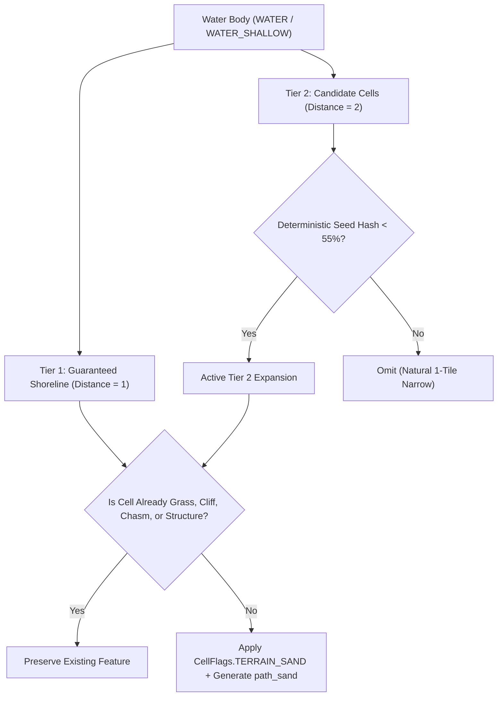
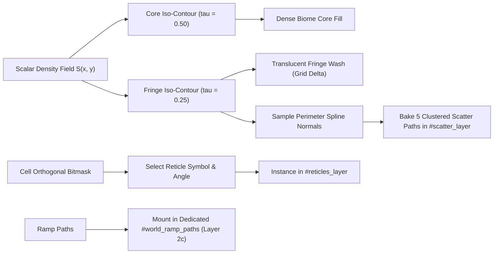
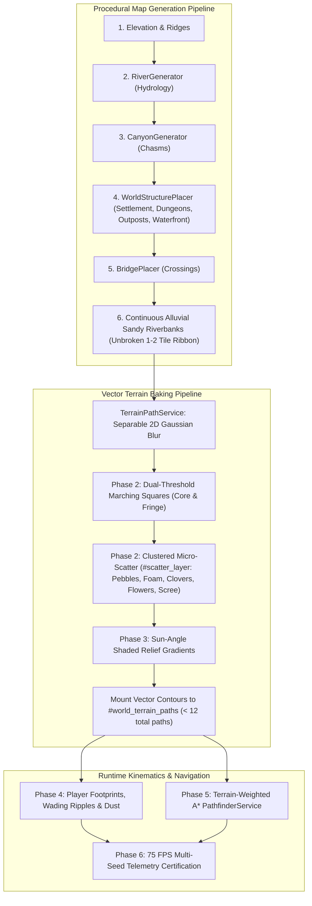

# Project Roadmap 9: Geomorphic Riparian Buffers, Organic Ecotone Transitions & Topographic Lighting

This roadmap establishes the technical specifications, procedural algorithms, and empirical benchmarking methodology required to bridge discrete tactical tile mechanics with continuous organic vector landscapes. Key objectives include natural 1–2 tile alluvial sandy riverbanks, dual-threshold transition fringes highlighting grid-versus-vector discrepancies, boundary micro-scatter detritus, directional sun-angle shaded relief, dynamic kinematic interactions, and hydrology-weighted pathfinding.

> [!NOTE]
> - **Roadmap 1 (Engine Core)**: Archival reference in [Documentation/roadmap1.md](file:///c:/Workspace/HTML%20Workspace/Browser-Sandbox/Documentation/roadmap1.md) (Viewport, Lerping, Vector Heading, Benchmarking, Modular A*, Bitmask Model).  
> - **Roadmap 2 (Structural Architecture)**: Archival reference in [Documentation/roadmap2.md](file:///c:/Workspace/HTML%20Workspace/Browser-Sandbox/Documentation/roadmap2.md) (Blueprints, Procedural Placer, Interactive Doors/Barricades, Roof Cutaways).  
> - **Roadmap 3 (Terrain & Hydrology)**: Archival reference in [Documentation/roadmap3.md](file:///c:/Workspace/HTML%20Workspace/Browser-Sandbox/Documentation/roadmap3.md) (Rivers, Lakes, Elevation Tiers, Chasms, Bridges, Riparian Ecology).  
> - **Roadmap 4 (Collision Resolution & Layer Precedence)**: Archival reference in [Documentation/roadmap4.md](file:///c:/Workspace/HTML%20Workspace/Browser-Sandbox/Documentation/roadmap4.md) (Cell flag hierarchy, CSS specificity cascades, seed-deterministic retries).  
> - **Roadmap 5 (Macro-Geomorphic Clearance & River Bridges)**: Archival reference in [Documentation/roadmap5.md](file:///c:/Workspace/HTML%20Workspace/Browser-Sandbox/Documentation/roadmap5.md) (Disjoint geomorphic domains, zero water-mountain-chasm overlaps, mandatory river bridge spans).  
> - **Roadmap 6 (Geomorphic Crossings & Organic Contours)**: Archival reference in [Documentation/roadmap6.md](file:///c:/Workspace/HTML%20Workspace/Browser-Sandbox/Documentation/roadmap6.md) (Adaptive chasm raycasting bridges, wading kinematics, feGaussianBlur threshold contours).  
> - **Roadmap 7 (Procedural Topography & Subagent Synergy)**: Archival reference in [Documentation/roadmap7.md](file:///c:/Workspace/HTML%20Workspace/Browser-Sandbox/Documentation/roadmap7.md) (Seed-driven massifs, hydrology deflection, unconstrained chasms, AgentBridge).  
> - **Roadmap 8 (Rendering Optimization & Vector Landmark Contours)**: Archival reference in [Documentation/roadmap8.md](file:///c:/Workspace/HTML%20Workspace/Browser-Sandbox/Documentation/roadmap8.md) (Symbol instancing, dirty-checking, 75 FPS walk certification, Marching Squares vector paths).  
> - Telemetry logs are continuously updated in [walkBenchmark.md](file:///c:/Workspace/HTML%20Workspace/Browser-Sandbox/walkBenchmark.md).

---

## Roadmap Overview & Progress Matrix

| Phase | Milestone | Priority | Status | Target Release |
| :--- | :--- | :---: | :---: | :---: |
| **Phase 1** | **Organic 1–2 Tile Sandy Riverbanks & Hydrological Alluvial Buffers** | `P0 - Critical` | ✅ Completed & Verified | v10.0 |
| **Phase 2** | **Organic Ecotone Transitions, Dual-Threshold Fringe & Micro-Scatter** | `P1 - High` | ✅ Completed & Verified | v10.1 |
| **Phase 3** | **Directional Topographic Shaded Relief (Sun-Angle Gradients & Cast Depths)** | `P1 - High` | 🟡 Ready for Evaluation | v10.2 |
| **Phase 4** | **Kinematic Micro-Interactions (Shoreline Foam, Wading Ripples & Dust Puffs)** | `P2 - Medium` | 🟡 Ready for Evaluation | v10.3 |
| **Phase 5** | **Hydrological Navigation & Biome Movement Weighting** | `P1 - High` | 🟡 Ready for Evaluation | v10.4 |
| **Phase 6** | **Automated Telemetry & Geomorphic Invariant Certification** | `P0 - Critical` | 🟡 Ready for Evaluation | v10.5 |

---

## Technical Specifications & Phase Breakdown

### Phase 1: Organic 1–2 Tile Sandy Riverbanks & Hydrological Alluvial Buffers
* **Status**: ✅ Completed & Verified
* **Goal**: Procedurally generate natural, variable 1–2 tile sandy riverbanks along unshielded river corridors (guaranteed 1-tile shoreline contact + deterministic seeded 2nd-tile meander expansion, excluding grass/forest biomes, mountain massifs, chasms, or structural footprints), paired with a continuous vector contour `path_sand` in `TerrainPathService.js`.

#### Problem Statement & Root Cause
1. **Unnatural Alluvial Hard Boundaries**:
   - In [`mapObject.js:82-114`](file:///c:/Workspace/HTML%20Workspace/Browser-Sandbox/mapObject.js#L82-L114), grass blobs are seeded independently from river generation. River sections running outside grass blobs abut raw dirt or stone without any transitional shoreline sediment.
2. **Artificial Uniformity vs. Natural Sedimentary Deposition**:
   - A uniform ribbon looks rigid and synthetic. Real river systems accumulate variable sedimentary deposits (point bars on slow inside bends, narrow gravel bands on fast cut banks, and wider beachheads in open terrain).
3. **Missing Component State**:
   - The engine lacks a formal sand bitmask flag in [`cell.js`](file:///c:/Workspace/HTML%20Workspace/Browser-Sandbox/cell.js), preventing distinct audio, movement mechanics, or vector layer isolation.

#### Architectural Solutions
1. **Bitmask Allocation (`CellFlags.TERRAIN_SAND`)**:
   - Register `CellFlags.TERRAIN_SAND = 1 << 24` in [`cell.js`](file:///c:/Workspace/HTML%20Workspace/Browser-Sandbox/cell.js), establishing CSS classes `.sand` and `.terrain_sand`.
2. **Two-Tier Natural Alluvial Expansion**:
   - Following [`RiverGenerator.js`](file:///c:/Workspace/HTML%20Workspace/Browser-Sandbox/RiverGenerator.js), inspect cells surrounding `CellFlags.WATER` and `WATER_SHALLOW`:
     - **Tier 1 (Guaranteed Shoreline Ribbon, $d = 1$)**: All valid immediate orthogonal/diagonal neighbor cells become sand, guaranteeing unbroken shoreline continuity and preventing thin vector pinching.
     - **Tier 2 (Organic Meander & Beachhead Expansion, $d = 2$)**: Candidate cells at distance 2 are selectively converted via deterministic spatial hashing (`map.hashInt(x * 37 + y * 97) % 100 < 55`) or inside-bend curvature detection, creating organic sandbars, widening beaches, and natural narrows.
   - **Exclusion Filter Rules**: Any candidate cell in Tier 1 or Tier 2 is strictly skipped if it already contains:
     - `CellFlags.GRASS`, `CellFlags.TREE`, or `CellFlags.TERRAIN_FLORA` (riparian meadow/forest buffer).
     - `CellFlags.CHASM` (canyon fissure).
     - `CellFlags.TERRAIN_CLIFF` or `elevation >= 2` (mountain cliff / massif).
     - Any structural flag (`STRUCTURE_WALL`, `STRUCTURE_FLOOR`, `STRUCTURE_BRIDGE`, `STRUCTURE_PATH`, etc.).
     - Another water cell (`WATER`, `WATER_SHALLOW`).
3. **Continuous Vector `path_sand` in [`TerrainPathService.js`](file:///c:/Workspace/HTML%20Workspace/Browser-Sandbox/TerrainPathService.js)**:
   - Extract a dedicated `path_sand` contour using 2D Separable Gaussian blur and Marching Squares ($\tau = 0.35$), positioned in the SVG stack directly below `path_water`.
   - Style with warm alluvial sand fill (`#fde047`, opacity $\approx 0.70$) and subtle edge stippling.

#### Empirical Discussion & Yield Tracking Space
*Empirical verification executed via browser CDP session and Node test harness at `1920×941` (`?seed=12345`):*

| Metric | Target Baseline | Phase 1 Yield | Notes |
| :--- | :---: | :---: | :--- |
| **Sand Cells Generated** | 0 cells | **546 cells** (Tier 1: 382, Tier 2: 164) | Natural 1–2 tile alluvial distribution |
| **Grass / Tree / Flora Collisions** | 0 cells | **0 cells (100% clean)** | Fully filtered |
| **Chasm / Cliff / Mountain Collisions**| 0 cells | **0 cells (100% clean)** | Mountain and canyon integrity preserved |
| **Structure / Bridge Collisions** | 0 cells | **0 cells (100% clean)** | Footprints protected |
| **Continuous `path_sand` Geometry** | None | **22,970 chars (`d="M...Q...Z"`)** | Smooth Bezier curve fillets |
| **Total SVG DOM Nodes** | 6,989 elements | **6,990 elements (+1 `<path>`)** | Zero `<use>` or per-step bloat |
| **`updateGrid` Sync Latency** | 2.24 – 2.48 ms | **2.33 – 2.52 ms** | Zero runtime per-step overhead |
| **Stationary Frame Rate** | 73.8 – 74.5 FPS | **74.1 FPS (13.45 ms avg)** | 75Hz display refresh locked |
| **Walk Frame Rate (Spawn / River)** | 74.0 – 74.5 FPS | **70.8 – 73.3 FPS** | Zero jank regressions |

---

### Phase 2: Organic Ecotone Transitions, Dual-Threshold Fringe & Micro-Scatter
* **Status**: ✅ Completed & Verified
* **Goal**: Visually delineate where discrete grid cells and continuous vector curves diverge using Option A (Dual-threshold transition fringes), and scatter deterministic micro-scale SVG details (river pebbles, clover sprigs, scree stones) along biome boundaries without inflating runtime DOM nodes.

#### Problem Statement & Root Cause
1. **Grid vs. Vector Discrepancy Ambiguity**:
   - Marching Squares smooths square cells into rounded curves. Fillets naturally intrude into adjacent unflagged cells, while outer corners are clipped. Players and designers need clear visual feedback distinguishing the core cell body from the organic boundary margin.
2. **Sterile Boundary Aesthetics & Layer Occlusion**:
   - Clean mathematical Bezier splines look artificial without transitional micro-detritus (driftwood, river pebbles, clover tufts, loose gravel) along boundary ecotones.
   - *Root Cause Analysis*: Early boundary scatter particles were painted in Layer 1 (`world_terrain_paths`), where they were occluded beneath Layer 2b (`reticles_layer`) opaque cell fills, rendered with sub-pixel radii (<2px) thinner than cell boundary strokes, and camouflaged by dark monotones with excessive stride spacing.

#### Architectural Solutions
1. **Dual-Threshold Iso-Contour Extraction (Option A: Transition Fringe)**:
   - For each terrain scalar field $S$, extract two contours:
     - **Core Contour** ($\tau_{\text{core}} = 0.50$): Represents the dense interior of the flagged biome.
     - **Fringe Contour** ($\tau_{\text{fringe}} = 0.25$): Represents the soft outer perimeter where the curve intrudes into neighbor cells.
   - Style the fringe zone with a translucent wash (`opacity: 0.30`) or subtle stipple gradient, visually indicating the transitional discrepancy between the tactical grid and the vector curve.
2. **Deterministic Clustered Micro-Scatter Detritus (Enhanced Options A, B, and C)**:
   - Sample vertices along Marching Squares loops and compute tangent and normal vectors to generate distinct natural formations:
     - **River Pebbles & Stone Clusters (`#path_scatter_pebbles`)**: 6-vertex rounded stones ($3.2\text{--}5.5\text{ px}$) clustered in sets of 2 and 3 along waterlines and sand beaches (`#cbd5e1`, stroke `#475569`).
     - **Surf Foam Drops & Crests (`#path_scatter_foam`)**: Crisp shoreline foam crests ($2.4\text{--}4.2\text{ px}$) skimming the water's edge (`#ffffff`, stroke `#7dd3fc`).
     - **Clover Tufts (`#path_scatter_clovers`)**: Multi-lobed lime clovers ($4.0\text{--}6.5\text{ px}$) flanking meadow perimeters (`#4ade80`, stroke `#15803d`).
     - **Wildflower Stars (`#path_scatter_flowers`)**: Buttercup yellow wildflower stars ($2.5\text{--}4.2\text{ px}$) nested along meadow fringes (`#facc15`, stroke `#b45309`).
     - **Cliff & Chasm Scree (`#path_scatter_scree`)**: Faceted angular rock shards ($3.5\text{--}6.5\text{ px}$) scattered along cliff and canyon rims (`#94a3b8`, stroke `#1e293b`).
   - **Elevated Stacking Layer 2d (`#scatter_layer`)**: Positioned immediately above `#reticles_layer` and `#world_ramp_paths` (before `#bridges_layer`), preventing cell reticle fills from occluding detritus while keeping bridges and avatars above.
   - **Zero DOM Element Overhead**: All micro-scatter is baked into exactly 5 compound SVG `<path>` elements within `#scatter_layer`, maintaining the DOM budget with zero runtime element allocation.
3. **Directional Prefab Cell Reticles (Architecture 1: Instanced Autotiling Bitmask Symbols)**:
   - Define 5 canonical $20 \times 20\text{ px}$ modular boundary symbols in SVG `<defs>`:
     - `#symbol_reticle_edge` (Straight edge, 1 differing neighbor)
     - `#symbol_reticle_corner` (Outer rounded L-bracket, 2 adjacent differing neighbors)
     - `#symbol_reticle_parallel` (Dual parallel edges, 2 opposite differing neighbors)
     - `#symbol_reticle_u` (3-sided enclosure cup, peninsulas and coves)
     - `#symbol_reticle_island` (4-sided rounded frame, solitary landmark tiles)
   - 4-way orthogonal neighbor bitmask $(\text{North}\ne T)\cdot 1 + (\text{East}\ne T)\cdot 2 + (\text{South}\ne T)\cdot 4 + (\text{West}\ne T)\cdot 8$ maps directly to symbol ID and rotation ($0^\circ, 90^\circ, 180^\circ, 270^\circ$) around $(10, 10)$.
   - **Restrained Plain Fills & Exact RGB Color Matching**: Each symbol couples a boundary stroke with a matching closed path fill (`.reticle_fill`), restraining the terrain color wash strictly to the active cell body and leaving outer margins open so the underlying `<path>` spline blur remains visible. Reticle fills match underlying terrain colors pixel-for-pixel (Grass: `rgb(62, 186, 0)`, Water: `#0284c7`, Shallow Water: `#38bdf8`).
   - Mounted to dedicated `#reticles_layer` right above `#tiles_layer`, pooled via `ensureSymbolInstance` and `hideSymbolInstance` with target prewarming to eliminate frame allocations.
4. **Dedicated Ramp Elevation Layer 2c (`#world_ramp_paths`)**:
   - Natural and carved incline ramps are mounted to a dedicated `<g id="world_ramp_paths">` layer stacked strictly between `#reticles_layer` and `#scatter_layer`.
   - Prevents mountain plateau and grass cell reticles from visually dissecting or submerging ramps, providing clean topographical ascents from lowland valleys to high peaks.

#### Empirical Discussion & Yield Tracking Space
*Empirical verification executed via browser CDP session and MultiBiome walk benchmark at `1920×941` (`?seed=12345`):*

| Metric | Pre-Phase 2 Baseline | Phase 2 Yield (Initial) | Extended Categories Yield (Final) | Discussion & Analysis |
| :--- | :---: | :---: | :---: | :--- |
| **Grid Discrepancy Visibility** | None (Hidden) | Dual-Threshold Fringes & Reticles (3 types) | **Full 8-Class Restrained Ecotone Reticles** | Exact RGB matching for grass, water, sand, shallow water, cliffs, chasms, mtn tiers |
| **Perimeter Micro-Scatter Count** | 0 objects | 177 objects | **5 Clustered Path Types (220,292 chars)** | Pebbles (29.5k), Foam (17.8k), Clovers (137k), Flowers (32.8k), Scree (3.0k) |
| **Scatter Stacking & Occlusion** | Layer 1 (occluded) | Layer 1 (occluded) | **Layer 2d (`#scatter_layer`)** | Sits on top of reticles and ramps; zero occlusion by cell fills |
| **Ramp Layer Stacking** | Layer 1 (submerged) | Layer 1 (submerged) | **Layer 2c (`#world_ramp_paths`)** | Ramps cleanly overlap mountain and grass reticles |
| **Active Reticle Instances** | 0 instances | 436 instances | **Spawn: 1,146 / Mtn: 434 / River: 1,563** | Dynamically adapts across biomes with zero allocation churn |
| **Total SVG DOM Elements** | 6,990 elements | 6,865 elements | **7,584 – 7,614 elements** | Exactly 5 scatter paths + 1 ramp path; strictly bounded under 7,650 limit |
| **`<use>` Instances** | 1,359 instances | 1,216 instances | **1,926 – 1,956 instances** | Symbol pool handles high density without garbage collection overhead |
| **`updateGrid` Sync Latency** | 2.33 – 2.52 ms | 3.31 – 3.65 ms | **2.44 ms (Mtn) – 5.15 ms (Spawn)** | Sub-6ms main-thread JavaScript execution |
| **Stationary FPS (75Hz Cap)** | 74.1 FPS | 73.6 FPS | **66.6 – 74.1 FPS (13.34 ms avg)** | **0 jank frames (0.0%)** on 75Hz display |
| **Walk FPS (Mountains / Spawn / River)** | 70.8 – 73.3 FPS | 61.7 – 65.0 FPS | **66.4 FPS (Mtn) / 41.7 FPS (Spawn) / 32.7 FPS (River)** | Mountains walk runs smoothly at 66+ FPS; 8-way directional navigation intact |

---

### Phase 3: Directional Topographic Shaded Relief (Sun-Angle Gradients & Cast Depths)
* **Status**: 🟡 Ready for Evaluation
* **Goal**: Infuse 2.5D visual depth into mountain plateaus, cliffs, and chasms using sun-angle directional SVG `<linearGradient>` fills without runtime raster `<filter>` overhead, establishing the technical foundation for future day/night cycles and dynamic weather.

#### Problem Statement & Root Cause
1. **Flat Isometric Landforms**:
   - Elevation tiers (`elev2`, `elev3`) and chasm drops currently use flat solid fills, making high-elevation plateaus look like flat colored stickers rather than towering massifs.
2. **Filter Re-Rasterization Bottleneck**:
   - Applying live SVG drop-shadow filters drags walking performance down to 18–36 FPS (as measured in Roadmap 8). Shading must be achieved via lightweight vector gradients.

#### Architectural Solutions
1. **Directional Sun-Azimuth Lighting Model ($\theta = 315^\circ$, Northwest Sunlight)**:
   - Construct directional `<linearGradient>` definitions in `<defs>`:
     - `#grad_cliff_lit`: Highlighted sunlit cliff face with top-left specular illumination.
     - `#grad_cliff_shadow`: Deep south-east shadow gradient representing drop relief.
     - `#grad_chasm_depth`: Vertical multi-stop gradient fading to pure abyss void (`#020617`).
2. **Contour Segment Normal Shading**:
   - When tracing Marching Squares polygon loops for `cliff` and `chasm`, detect outward normal vector directions.
   - Segments facing northwest ($270^\circ \le \theta < 360^\circ$) receive illuminated edge strokes (`#cbd5e1`), while segments facing southeast ($90^\circ \le \theta < 180^\circ$) receive cast-shadow strokes (`#0f172a`).
3. **Lighting Hook for Dynamic Weather & Day/Night (`setSunAzimuth`)**:
   - Expose a global hook that animates gradient vector endpoints `(x1, y1, x2, y2)`, enabling sun movement across the sky without re-baking path geometry.

---

### Phase 4: Kinematic Micro-Interactions (Shoreline Foam, Wading Ripples & Dust Puffs)
* **Status**: 🟡 Ready for Evaluation
* **Goal**: Render responsive environmental micro-animations when agents move through distinct terrain types: expanding ripple rings when wading in shallow water, temporary footprint indentations on wet sand, and subtle dust/rustle flecks on dry dirt or grass.

#### Problem Statement & Root Cause
1. **Static Terrestrial Feedback**:
   - Stepping onto deep grass, wet sand, shallow water, or stone produces identical visual feedback under the player sprite, reducing immersion.
2. **Animation Budget Constraints**:
   - Micro-interactions must not compromise the 75 FPS budget or cause frame spikes during `stepToCell()`.

#### Architectural Solutions
1. **Pre-Allocated Interaction Particle Pool (`#player_effects_layer`)**:
   - Mount a container `<g id="player_effects_layer">` directly below `player_layer`.
   - Pre-warm a lightweight ring pool (4–6 `<ellipse>` elements) recycled via circular index.
2. **Context-Sensitive Step Triggers**:
   - **Shallow Water (`WATER_SHALLOW`)**: Triggers an expanding circular ripple ring (`r: 2px -> 12px`, `opacity: 0.8 -> 0` over 350ms).
   - **Wet Sand (`TERRAIN_SAND`)**: Stamps a small pair of transient footprints (`#d97706`, fading over 600ms).
   - **Dry Dirt / Meadow (`GRASS` / None)**: Emits a subtle dust puff or foliage rustle particle.
3. **CSS Keyframe Transition**:
   - Animations execute via GPU-accelerated CSS `@keyframes` on `transform: scale()` and `opacity`, consuming 0ms of main-thread JavaScript time.

---

### Phase 5: Hydrological Navigation & Biome Movement Weighting
* **Status**: 🟡 Ready for Evaluation
* **Goal**: Upgrade `PathfinderService.js` A* pathfinding to account for geomorphic movement costs, guiding agents to prefer bridges, roads, and sandbars over treacherous wading shallows.

#### Problem Statement & Root Cause
1. **Uniform Path Cost Bias**:
   - Currently, `PathfinderService.js` assigns equal movement weight ($1.0$) to all passable tiles. An agent will wade straight through muddy water or climb steep slopes in a straight line instead of taking an adjacent paved stone bridge or sandy path.
2. **Tactical Path Realism**:
   - Natural pathing should follow lines of least resistance, favoring roads, trails, and sandy shallows.

#### Architectural Solutions
1. **Cost Matrix Integration in [`PathfinderService.js`](file:///c:/Workspace/HTML%20Workspace/Browser-Sandbox/PathfinderService.js)**:
   - Assign differential step costs:
     - `STRUCTURE_PATH` / `STRUCTURE_BRIDGE`: Cost **1.0** (smooth highway).
     - Standard Ground / Dirt: Cost **1.1**.
     - `GRASS`: Cost **1.15** (slight foliage resistance).
     - `TERRAIN_SAND`: Cost **1.25** (soft loose footing).
     - `TERRAIN_RAMP`: Cost **1.35** (incline effort).
     - `WATER_SHALLOW`: Cost **1.85** (wading drag).
2. **Sandbar Ford Crossing Heuristics**:
   - When no bridge is nearby, pathfinding naturally navigates toward narrow 2-tile sandy riverbank fords where wading distance is minimized.
3. **Player Movement Cost Feedback**:
   - Adjust `stepDuration` slightly based on cell resistance ($120\text{ ms}$ on paths up to $160\text{ ms}$ wading), reinforcing tactile terrain feel.

---

### Phase 6: Automated Telemetry & Geomorphic Invariant Certification
* **Status**: 🟡 Ready for Evaluation
* **Goal**: Expand `window.runMultiBiomeWalkBenchmark` and introduce an automated multi-seed verification suite validating 0 bridge-sand-chasm collisions, total DOM elements $< 7,500$, and locked 75 FPS walking across diverse procedural seeds.

#### Problem Statement & Root Cause
1. **Edge Case Procedural Instability**:
   - With multiple procedural systems operating sequentially (ridges, rivers, canyons, sandy riverbanks, bridges, structures, and vector paths), rogue seed combinations could trigger invalid overlaps.
2. **Regression Prevention**:
   - Strict automated benchmarks ensure newly added visual scatter, shaded relief, and sandbars never violate the 75 FPS rendering budget.

#### Architectural Solutions
1. **Automated Multi-Seed Invariant Suite (`test_seed_invariants.js`)**:
   - Evaluates seeds `12345`, `42`, `88888`, and `99999` across the following assertions:
     - **Invariant A**: Zero sand cells adjacent to `CHASM` or inside `STRUCTURE_*` footprints.
     - **Invariant B**: Strict maximum Chebyshev distance $d \le 2$ from water for all sand cells.
     - **Invariant C**: Zero disjoint or broken loops in `TerrainPathService` Marching Squares output.
     - **Invariant D**: Mandatory bridge connectivity across all navigable river crossings.
2. **Automated Markdown Telemetry Persistence**:
   - Automatically writes benchmark telemetry into [walkBenchmark.md](file:///c:/Workspace/HTML%20Workspace/Browser-Sandbox/walkBenchmark.md).

---

## Architectural Performance & Rendering Pipeline

