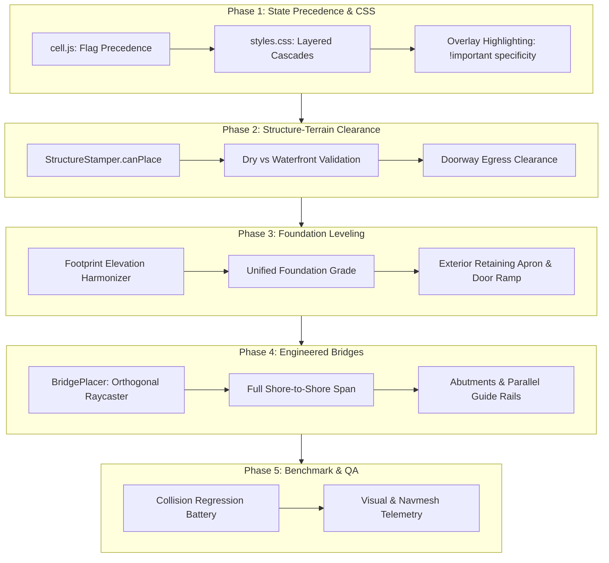

# Project Roadmap: Collision Resolution, Layer Precedence & Structural Integrity

This roadmap outlines the engineering strategy to resolve cell-level and structure-level collisions, layer precedence overrides, visual CSS cascade masking, bridge-gap spanning, and foundation elevation leveling across the Grid Engine world.

> [!NOTE]
> - **Roadmap 1 (Engine Core)**: Archival reference in [Documentation/roadmap1.md](file:///c:/Workspace/HTML%20Workspace/Browser-Sandbox/Documentation/roadmap1.md) (Viewport, Lerping, Vector Heading, Benchmarking, Modular A*, Bitmask Model).  
> - **Roadmap 2 (Structural Architecture)**: Archival reference in [Documentation/roadmap2.md](file:///c:/Workspace/HTML%20Workspace/Browser-Sandbox/Documentation/roadmap2.md) (Blueprints, Procedural Placer, Interactive Doors/Barricades, Roof Cutaways).  
> - **Roadmap 3 (Terrain & Hydrology)**: Archival reference in [Documentation/roadmap3.md](file:///c:/Workspace/HTML%20Workspace/Browser-Sandbox/Documentation/roadmap3.md) (Rivers, Lakes, Elevation Tiers, Chasms, Bridges, Riparian Ecology).  
> - Experimental concepts remain tracked in [sandbox.md](file:///c:/Workspace/HTML%20Workspace/Browser-Sandbox/sandbox.md).

---

## Roadmap Overview & Progress Matrix

| Phase | Milestone | Priority | Status | Target Release |
| :--- | :--- | :---: | :---: | :---: |
| **Phase 1** | **Cell State Precedence & CSS Visual Hierarchy** | `P1 - High` | ✅ Completed | v5.0 |
| **Phase 2** | **Structure-Terrain Clearance & Placement Validation** | `P1 - High` | ✅ Completed | v5.1 |
| **Phase 3** | **Foundation Leveling & Elevation Topographic Integrity** | `P2 - Medium` | ✅ Completed | v5.2 |
| **Phase 4** | **Engineered Bridge Spanning & Abutment Alignment** | `P2 - Medium` | ✅ Completed | v5.3 |
| **Phase 5** | **Collision Regression Suite & End-to-End Validation** | `P3 - Low` | ✅ Completed | v5.4 |

---

## Technical Specifications & Phase Breakdown

### Phase 1: Cell State Precedence & CSS Visual Hierarchy
* **Status**: ✅ Completed

#### Problem Statement & Root Cause
1. **Structure Floor vs Water Contradiction (`cell structure_floor elev_0 water`)**:
   - When a structure blueprint is stamped on or near water, cells acquire both `STRUCTURE_FLOOR` and `WATER` flags.
   - In [cell.js](file:///c:/Workspace/HTML%20Workspace/Browser-Sandbox/cell.js), `isBlockedType()` checks `WATER` as blocked unless marked as `STRUCTURE_PATH` or `STRUCTURE_BRIDGE`. Because `STRUCTURE_FLOOR` is omitted from this exemption list, interior building floors over water become impassable barriers!
   - Visually, the cell receives both `.structure_floor` and `.water`, creating conflicting styles where water styling or elevation $0$ overrides or muddies the interior floor.
2. **Pathfinding & Selection Highlighting Masked by Cascade Order**:
   - In [styles.css](file:///c:/Workspace/HTML%20Workspace/Browser-Sandbox/styles.css), highlighting classes (`.cell.selected`, `.cell.path_step`, `.cell.selectedDestination`) are declared early (lines 48–60).
   - Subsequent terrain, hydrology, and structural rules (`.cell.water`, `.cell.structure_floor`, `.cell.structure_bridge`, `.cell.elev_2`, `.cell.elev_3`, `.cell.chasm`) are defined lower in the stylesheet with identical CSS specificity (`0-1-0` or `0-2-0`).
   - By standard CSS cascade rules, the later rules override the earlier highlight fills. Consequently, clicking on water, bridges, paths, highlands, or structure floors fails to display destination beacons or path step trails!
3. **Other Cell-Level Collisions Reviewed**:
   - `TREE` inside `WATER`: Trees randomly generated on river basins or lakeshores.
   - `BLOCKED` rocks inside `STRUCTURE_PATH` or `STRUCTURE_FLOOR`.
   - `TERRAIN_CLIFF` applied to `STRUCTURE_BRIDGE`: Bridge decks erroneously tagged with cliff boundaries, creating confusing conflicting visuals.
   - `CHASM` beneath `STRUCTURE_FLOOR`: Buildings floating over bottomless chasms.

#### Architectural Solutions
1. **Explicit Flag Override & Sanitization Rules**:
   - Establish an authoritative state hierarchy during cell mutation:
     $$\text{STRUCTURE\_FLOOR} \succ \text{STRUCTURE\_WALL} \succ \text{STRUCTURE\_PATH} \succ \text{TERRAIN (WATER, TREE, BLOCKED, CHASM)}$$
   - When `STRUCTURE_FLOOR` or `STRUCTURE_WALL` is applied to a cell:
     - Automatically purge `WATER`, `WATER_SHALLOW`, `TREE`, `BLOCKED`, `CHASM`, and `TERRAIN_CLIFF`.
     - Elevate cell elevation to the structure's dry foundation grade ($h \ge 1$).
   - Update `cell_meta.isBlockedType()` to ensure `STRUCTURE_FLOOR` guarantees interior passability.
2. **CSS Specificity & Layered Visual Order Overhaul**:
   - Restructure [styles.css](file:///c:/Workspace/HTML%20Workspace/Browser-Sandbox/styles.css) into distinct rendering layers using higher specificity selectors:
     ```css
     /* Layer 1: Base Terrain & Elevation Tiers */
     .cell { ... }
     .cell.elev_0, .cell.elev_2, .cell.elev_3 { ... }
     .cell.water, .cell.water_shallow { ... }
     .cell.chasm, .cell.cliff { ... }

     /* Layer 2: Biome Vegetation & Natural Obstacles */
     .cell.grass { ... }
     .cell.tree { ... }
     .cell.flora { ... }

     /* Layer 3: Built Infrastructure & Architecture */
     .cell.structure_floor { ... }
     .cell.structure_path { ... }
     .cell.structure_bridge { ... }
     .cell.structure_wall { ... }
     .cell.structure_door { ... }

     /* Layer 4: Interactive Selection & Navigation Overlays (Highest Priority) */
     #frame .cell.selected,
     #frame .cell.selected.path_step {
         fill: rgba(74, 222, 128, 0.75) !important;
         stroke: #16a34a !important;
     }
     #frame .cell.path_step {
         fill: rgba(239, 68, 68, 0.85) !important;
         stroke: #dc2626 !important;
     }
     #frame .cell.selectedDestination {
         fill: rgba(56, 189, 248, 0.9) !important;
         stroke: #0284c7 !important;
         stroke-width: 1.5px !important;
     }
     ```
   - Guarantees navigation beacons and path trails are 100% visible across every tile type in the engine.

---

### Phase 2: Structure-Terrain Clearance & Placement Validation
* **Status**: ✅ Completed

#### Problem Statement & Root Cause
1. **Structures Stamping Over Terrain Landforms**:
   - In [StructureStamper.js](file:///c:/Workspace/HTML%20Workspace/Browser-Sandbox/StructureStamper.js), `canPlace()` only checked collisions against existing `STRUCTURE_WALL` and `STRUCTURE_FLOOR`.
   - It did **not** check for `WATER`, `CHASM`, or steep `TERRAIN_CLIFF` drop-offs.
   - Consequently, procedural generators ([WorldStructurePlacer.js](file:///c:/Workspace/HTML%20Workspace/Browser-Sandbox/WorldStructurePlacer.js)) frequently placed dryland buildings (woodland cabins, lumber camps, watchtowers, BSP catacombs) halfway submerged in rivers or bisected by chasms.
2. **Terrain Landforms Carving Through Structures**:
   - `RiverGenerator` and `CanyonGenerator` ran checks against some structure flags, but if placement occurred in variable order or near perimeter footprints, geological fissures could sever buildings.
3. **Other Structure-Level Collisions Reviewed**:
   - Doorway obstruction: Structure entry doors opening directly into water bodies, cliff walls, or dense tree trunks.
   - Trail bisection: Newly placed structures bulldozing established trails without creating bypasses or connecting doorways.

#### Architectural Solutions
1. **Category-Aware Placement Constraints in `StructureStamper.canPlace()`**:
   - Extend `canPlace(map, blueprint, originX, originY)` to evaluate terrain fitness based on blueprint category and tags:
     - **Dry Terrestrial Buildings** (`cabin`, `camp`, `outpost`, `ruins`, `dungeon`):
       - Must have $0\%$ overlap with `CellFlags.WATER` and `CellFlags.CHASM`.
       - Must have a flat uniform elevation grade across the footprint ($\Delta h = 0$).
       - Doorway coordinate must open onto dry, unblocked land with at least 1 tile clearance.
     - **Waterfront Structures** (`watermill`, `fishing_pier`):
       - Specifically require land on the entrance side and water on the active side (paddlewheel / pier head).
     - **Infrastructure & Bridges** (`bridge`, `ramp`):
       - Specifically permitted over water or chasm cells when anchored to land shores.
2. **Strict Procedural Pipeline Ordering & Exclusion Buffers**:
   - Geological landforms (hydrology, heightmap, canyons) establish the natural world first.
   - Structure placers query both structural and geological mask layers before committing footprints.
   - Doorway clearance verification ensures every structure has an unblocked, navigable egress threshold.

---

### Phase 3: Foundation Leveling & Elevation Topographic Integrity
* **Status**: ✅ Completed

#### Problem Statement & Root Cause
1. **Multi-Tier Elevation Splitting Inside Structures**:
   - When a structure spans an elevation transition (e.g. from lowland $h = 1$ to highland $h = 2$), individual rooms inside the building inherit different elevation numbers.
   - Because elevation boundaries without ramps are impassable, players moving inside the building can hit an invisible internal cliff between two floor tiles in the same room!
2. **Cliff Contours Running Through Interior Living Spaces**:
   - Cells adjacent to the elevation step get tagged with `TERRAIN_CLIFF`, rendering cliff outlines and shadows across indoor wood planks.

#### Architectural Solutions
1. **Foundation Leveling Engine (`FoundationService`)**:
   - When stamping any building structure:
     - Determine the dominant elevation tier $h_{\text{foundation}}$ across the candidate footprint (e.g., median or mode elevation).
     - Force all footprint cells ($x \in [\text{startX}, \text{endX}], y \in [\text{startY}, \text{endY}]$) to uniform elevation $h_{\text{foundation}}$.
     - Clear `TERRAIN_CLIFF` within the structure footprint.
2. **Retaining Wall & Apron Smoothing**:
   - Push any necessary cliff grade transitions to the exterior boundary of the structure.
   - If the doorway exits toward a differing elevation tier, automatically stamp a stone stair / ramp (`TERRAIN_RAMP`) directly outside the entrance.

---

### Phase 4: Engineered Bridge Spanning & Abutment Alignment
* **Status**: ✅ Completed

#### Problem Statement & Root Cause
1. **Bridges Failing to Span the Full Gap (`cell structure_path structure_bridge cliff`)**:
   - In `carveTrail()`, trails crossing water stepped with random 50/50 diagonal walks. When intersecting a 2-to-3 tile wide river at an oblique angle, only isolated water cells were tagged with `STRUCTURE_BRIDGE`.
   - The bridge appeared disjointed, leaving open water on adjacent tiles or stopping in the middle of the river.
   - Furthermore, because riverbanks often bordered cliff contours, shoreline cells inherited both `STRUCTURE_BRIDGE` and `TERRAIN_CLIFF`, causing conflicting passability logic and visual glitches.
2. **Lack of Engineered Bridge Abutments**:
   - Real bridges require firm ground anchors (abutments) on both shores. Currently, bridge decks end abruptly at the water's edge without seamless connection to the trail network.

#### Architectural Solutions
1. **Orthogonal Gap Raycasting & Full-Span Raytracer in `BridgePlacer.js`**:
   - Instead of merely tagging individual trail steps, `BridgePlacer` traces a complete orthogonal ray across the channel:
     - When a trail reaches water/chasm at `ShoreA (x1, y1)`:
     - Raycast across the channel along the primary axis (Horizontal $E \leftrightarrow W$ or Vertical $N \leftrightarrow S$) until reaching solid land at `ShoreB (x2, y2)`.
     - Stamp an unbroken line of bridge deck cells (`STRUCTURE_BRIDGE | STRUCTURE_PATH`) from `ShoreA` to `ShoreB`.
     - Remove `WATER`, `CHASM`, and `TERRAIN_CLIFF` from the bridge deck line.
2. **Dual-Sided Guardrails & Solid Shore Abutments**:
   - Flank the entire span with parallel guide rails (`STRUCTURE_WALL`) on the water sides to prevent walking off the deck into deep water.
   - Stamp solid stone/wood bridge abutments on both shoreline connection tiles, ensuring seamless transition between road and bridge.

---

### Phase 5: Collision Regression Suite & End-to-End Validation
* **Status**: ✅ Completed

#### Motivation & Deliverables
1. **Automated Collision & Precedence Test Battery in `benchmark.js`**:
   - Add specialized regression test cases verifying:
     - Pathfinding through a structure stamped near or over water (confirming 100% floor passability).
     - Pathfinding across full-span river bridges and canyon suspension crossings.
     - Destination beacon and path-step highlighting visibility on water, bridge, cliff, and highland tiles.
2. **Interactive Browser Subagent Verification**:
   - Inspect DOM elements to verify CSS class composition and lack of contradictory combinations (e.g. no `structure_floor water` or `structure_bridge cliff`).
   - Visually confirm that selection highlights, path steps, and destination beacons render vibrantly over all biomes.

---

## Technical Specifications & Class Contracts



---

## Architectural Class Contracts & Mutation Invariants

```
+---------------------------------------------------------------------------------+
|                                 cell.js Invariants                              |
|  - If (flags & STRUCTURE_FLOOR): flags &= ~(WATER | WATER_SHALLOW | CHASM)      |
|  - If (flags & STRUCTURE_BRIDGE): flags &= ~(TERRAIN_CLIFF | CHASM)             |
|  - If (flags & STRUCTURE_PATH): flags &= ~(TREE | BLOCKED)                      |
|  - isBlockedType(): STRUCTURE_FLOOR and STRUCTURE_BRIDGE are always passable     |
+---------------------------------------------------------------------------------+
                                         |
                                         v
+---------------------------------------------------------------------------------+
|                             StructureStamper.canPlace                           |
|  - Dry Structures: assert(cells.every(c => !c.hasFlag(WATER | CHASM)))          |
|  - Waterfront Structures: assert(shoreContact && waterAdjacent)                 |
|  - Doorway Check: assert(doorwayCell.hasClearance(1) && !doorwayCell.isWater)   |
+---------------------------------------------------------------------------------+
                                         |
                                         v
+---------------------------------------------------------------------------------+
|                               BridgePlacer Engine                               |
|  - raycastCrossing(shoreA, shoreB): spans 100% of water gap without gaps       |
|  - stampAbutments(shoreA, shoreB): anchors both ends into solid terrain          |
|  - buildGuideRails(span): places parallel STRUCTURE_WALL along bridge flanks   |
+---------------------------------------------------------------------------------+
```
